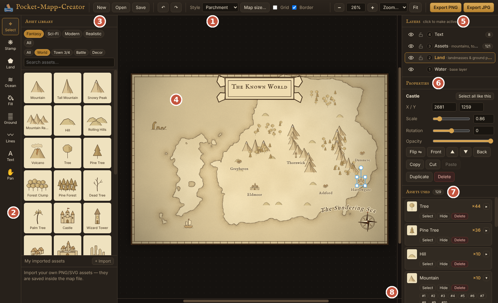
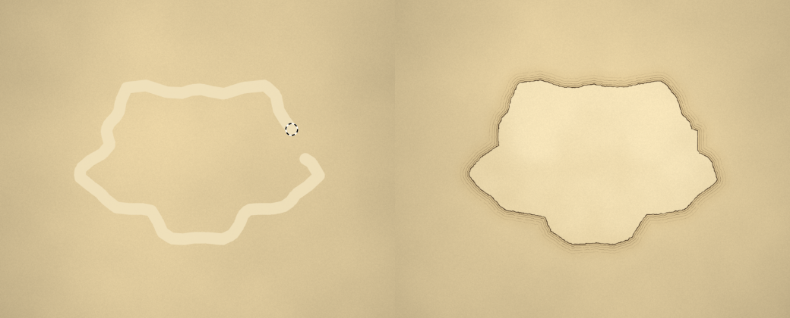

# Pocket-Mapp-Creator User Guide

Version 0.3

Pocket-Mapp-Creator is a desktop map maker for fantasy, sci-fi, modern and realistic maps: paint land, stamp on mountains, towns and ships, add labels, then export a PNG or JPG. This guide covers version 0.3.

## Contents

1. [Installing and starting](#1-installing-and-starting)
2. [The screen at a glance](#2-the-screen-at-a-glance)
3. [Your first map in 10 steps](#3-your-first-map-in-10-steps)
4. [Map types and styles](#4-map-types-and-styles)
5. [Layers](#5-layers)
6. [Working with land](#6-working-with-land)
7. [Placing and editing assets](#7-placing-and-editing-assets)
8. [Rivers, roads and borders](#8-rivers-roads-and-borders)
9. [Rooms, textures and effects](#9-rooms-textures-and-effects)
10. [Random maps, realms and linked maps](#10-random-maps-realms-and-linked-maps)
11. [Text labels](#11-text-labels)
12. [Moving around the map](#12-moving-around-the-map)
13. [Map size, saving and exporting](#13-map-size-saving-and-exporting)
14. [Keyboard shortcuts](#14-keyboard-shortcuts)
15. [Troubleshooting](#15-troubleshooting)
16. [Licences and credits](#16-licences-and-credits)

## 1. Installing and starting

Download the installer for your computer from the project's GitHub **Releases** page, run it, then start Pocket-Mapp-Creator like any other program.

| Computer | File to download | Notes |
| --- | --- | --- |
| Windows | `Pocket-Mapp-Creator-…-win-x64.exe` | Installs the app and adds a Start menu shortcut |
| Windows (no install) | `Pocket-Mapp-Creator-…-win-portable.exe` | Runs straight away, e.g. from a USB stick |
| Mac with Apple chip (M1 or later) | `Pocket-Mapp-Creator-…-mac-arm64.dmg` | Open it and drag the app into Applications |
| Mac with Intel chip | `Pocket-Mapp-Creator-…-mac-x64.dmg` | As above |
| Linux | `Pocket-Mapp-Creator-…-linux-x86_64.AppImage` | Mark it as executable, then double-click it |
| Debian / Ubuntu | `Pocket-Mapp-Creator-…-linux-amd64.deb` | Install with your software centre or `sudo apt install ./file.deb` |

**First-run warnings.** The installers are not code-signed, so your computer may warn you the first time:

- **Windows:** if SmartScreen says "Windows protected your PC", click **More info**, then **Run anyway**.
- **Mac:** right-click the app and choose **Open**, then **Open** again. If macOS says the app "is damaged", run `xattr -cr "/Applications/Pocket-Mapp-Creator.app"` in Terminal, then try again.

**The welcome window.** Every time the app starts it shows the welcome window. Choose:

1. **Map type**: World / Region, Town / City / Village, or Battle Map.
2. **Style**: Parchment, Full colour, Watercolour, Copperplate or Night & Gold. You can change this later at any time.
3. **Size**: pick a preset or type a width and height in pixels (200 to 8000).
4. **Name**: the map's title, used when you save and export.

Click **Create map**, or **Open existing…** to carry on with a map you saved before. Every new map starts as open ocean, ready for you to paint the land.

**🎲 Random map…** creates the map and then rolls a random world, town or dungeon on it (section 10). **Explore an example map** opens a finished world map you can take apart to see how it was made. If the app closed before you saved, the welcome window also shows **Recover unsaved map**: the app saves a backup copy every minute while there are unsaved changes.

## 2. The screen at a glance

The map sits in the middle; tools are on the left, layers and settings on the right.

| # | Area | What it does |
| --- | --- | --- |
| 1 | **Top bar** | New, Open, Save, Undo/Redo, map **Style**, **Map size**, Grid, **Snap** and Border switches, zoom controls, Export PNG, Export JPG and **More…** (SVG, PDF, Print). After you open a linked map, a blue **◀ Back** button appears here |
| 2 | **Tool bar** | Select, Stamp, Land, Ocean, Fill, Texture, Ground, Lines, Shapes, Dungeon, Text, Measure and Pan |
| 3 | **Asset library** | Every built-in asset, filtered by genre (Fantasy, Sci-Fi, Modern, Realistic) and view (World, Town 3/4, Battle, Decor), plus a search box and your imported assets |
| 4 | **Map area** | Where you paint and place things |
| 5 | **Layers** | Water, Land, Assets and Text: show, hide, lock, and choose which one you are working on |
| 6 | **Properties** | Settings for whatever is selected, or for the map when nothing is |
| 7 | **Assets used** | Every kind of item on the map with a count, so you can select, hide or delete all copies at once |
| 8 | **Scroll bars** | Move around the map when you are zoomed in |

When a drawing tool is chosen, a small bar of options for it appears at the top of the map area.

## 3. Your first map in 10 steps

Work from the bottom layer up: land first, then features, then labels.

1. In the welcome window choose **World / Region**, **Parchment**, the first size preset, and click **Create map**.
2. Choose **Land** in the tool bar. In the bar above the map, set **Size** to about 60.
3. Draw the outline of your continent in one stroke. If you finish near where you started, the ends join up by themselves.
4. Choose **Fill** (the paint bucket) and click inside the outline. It fills solid, and the coastline and sea ripples are inked for you.
5. Use **Ocean** to carve bays and lakes, and **Land** to add islands.
6. In the asset library pick **Mountain**. In the Stamp bar tick **Scatter brush** and drag across the land to paint a mountain range. Do the same with **Pine Tree** for forests.
7. Untick Scatter brush and click to place single items: **Castle**, **Village**, **Walled City**. Put ships, rocks and a **Compass Rose** in the sea.
8. Choose **Lines**, pick **River**, and drag from the mountains to the sea.
9. Choose **Text**, pick a font and size in the bar, then click where each name should go. Add a **Title Cartouche** from the Decor assets and a title label on top of it.
10. Click **Save** to keep a `.mapp` file you can reopen, then **Export PNG** for a picture to share or print.

## 4. Map types and styles

The map type decides which assets the library shows first and whether a grid is on; the style decides how everything is drawn.

| Map type | Use it for | Assets it opens with | Default size |
| --- | --- | --- | --- |
| World / Region | Continents, kingdoms, coastlines | World: side-view mountains, forests, castles, cities | 3000 × 2000 px |
| Town / City / Village | Streets and settlements | Town 3/4: houses, taverns, walls, docks seen at an angle | 2400 × 1800 px |
| Battle Map | RPG encounters, tavern and dungeon interiors | Battle: top-down trees, rocks, furniture, dungeon traps, ships, with a square grid | 1400 × 1400 px (20 × 20 squares of 70 px) |

| Style | Looks like |
| --- | --- |
| Parchment | Sepia ink on aged paper, hatched mountains, ripple lines round every coast |
| Full colour | Bold game-map colours, sandy beaches, shallow water |
| Watercolour | Soft washes with darker pigment at the edges |
| Copperplate | An engraved atlas: fine dark ink on ivory, closely hatched seas |
| Night & Gold | Cream ink and gold on midnight-blue paper |

Change the style at any time from **Style** in the top bar; every asset and the coastline redraw in the new style. Change the map type from **Type** in Properties (press Esc so nothing is selected, and Properties shows the map's settings). Assets from any type can be used on any map: the filters only decide what is listed.

## 5. Layers

Everything on a map sits on one of four layers, stacked like sheets of tracing paper: water at the bottom, text always on top.

| # | Layer | Holds | Selected with the Select tool by |
| --- | --- | --- | --- |
| 4 | **Text** | Every label and the map key | Clicking a label |
| 3 | **Assets** | Mountains, trees, towns, ships, bridges, rooms, the dungeon floor plan, realms, and all rivers, roads and borders | Clicking an item, or dragging a box round several |
| 2 | **Land** | Landmasses, texture paint and ground paint (roads, dirt, clearings) | Clicking anywhere on land, even under mountains or towns |
| 1 | **Water** | The sea; the base of the map | Not selectable |

**The active layer.** The Select tool only picks things on the active layer, which is highlighted in the Layers panel. Click a layer's name to make it active, or press **1** for Land, **2** for Assets, **3** for Text. Drawing tools switch for you: Land, Ocean, Fill, Texture and Ground use Land; Stamp, Lines, Shapes and Dungeon use Assets; Text uses Text.

**Eye button.** Hides a layer. Hidden layers are also left out when you export, which is handy for a copy of the map without labels.

**Padlock.** Locks a layer so nothing on it can be selected, moved or painted by accident.

If you click on land while the Assets or Text layer is active, a hint at the bottom of the map reminds you to switch to the Land layer.

## 6. Working with land

Land is painted, not placed: brush it on, fill outlines, then select whole landmasses to move or resize them. Coastlines and sea ripples are drawn automatically whenever you let go of the mouse.

### Land and Ocean brushes

| Tool | Key | What it does |
| --- | --- | --- |
| **Land** | B | Paints land |
| **Ocean** | E | Paints sea, rubbing land away: for bays, lakes, channels and islands |
| **Ground** | P | Paints roads, dirt and clearings on top of land (Paint or Erase) |

In the bar above the map, **Size** sets the brush width (or press **[** and **]**), and **Rough edge** gives a natural, ragged coast. Hold **Alt** while painting to swap between Land and Ocean. With the Land brush, **Auto-close outlines** joins the two ends of a stroke that finishes near where it started.

### Fill bucket

The quickest way to make a continent: draw its outline, then fill it.

1. Draw the coastline with the **Land** brush.
2. Choose **Fill** (the paint bucket, key **G**).
3. Click inside the outline, on the water. It becomes solid land right up to the coast.

*Left: a hand-drawn outline with a gap. Right: one click with the Fill bucket.*

- **Close gaps** (in the Fill bar) seals small breaks in an outline. The fill also tries wider gaps by itself before giving up.
- If the outline really is open, nothing is filled: a message explains why and the sea it would have flooded flashes red. Join the outline with the Land brush and try again.
- **Fill with water** mode does the opposite: click a piece of land to turn all of it into sea.

### Selecting, moving and resizing a landmass

1. Make **Land** the active layer (click it in the Layers panel, or press **1**).
2. Choose **Select** and click the land. Every piece of land joined to that spot gets an orange box with handles.
3. Drag a **corner square** to make it bigger or smaller, drag **inside the box** to move it, or drag the **round handle** to rotate it (hold Shift to snap to 15°).
4. Click **Done**, click the sea, or press **Esc** to finish. The coastline is redrawn at the new size.

The Properties panel lets you type an exact **Size %** and **Rotation**, and has **Smaller**, **Bigger**, **Reset** and **Delete land** buttons. Everything standing on the land (mountains, towns, roads, labels) moves and scales with it unless you untick **Move items on this land with it**.

Two islands that touch count as one landmass; separate them with the Ocean brush if you want to resize just one.

## 7. Placing and editing assets

There are 157 built-in assets, each drawn in all five styles: mountains, forests, castles, towns, ships, docks, bridges, sea rocks, sci-fi bases, modern buildings and more.

### Finding an asset

In the asset library, choose a genre (**Fantasy**, **Sci-Fi**, **Modern**, **Realistic** or **All**), then a view: **World** for side-view map icons, **Town 3/4** for buildings seen at an angle, **Battle** for top-down pieces, or **Decor** for compasses, banners, ships and sea monsters. Or type in **Search assets** (for example "ship", "bridge" or "rock").

### Placing assets

Click a tile to pick it up (the **Stamp** tool turns on), then click the map. You can also drag a tile straight onto the map. The Stamp bar above the map has:

- **Scale**: the size new items are placed at.
- **Scatter brush**: drag to paint many copies, for forests and mountain ranges. **Spacing**, **Size ±**, **Rotate ±** and **Random flip** make the copies varied.
- **Depth sort**: keeps lower items in front of higher ones, so ranges and forests overlap naturally.

### Editing assets

With **Assets** as the active layer, choose **Select** and click an item. Shift-click or drag a box to select several.

| To | Do this |
| --- | --- |
| Move | Drag it, or nudge with the arrow keys (hold Shift for 10 px) |
| Resize | Drag a corner square, press **[** or **]**, or type a **Scale** in Properties |
| Rotate | Drag the round handle (Shift snaps to 15°), press **R**, or type a **Rotation** |
| Flip | Press **F** or click **Flip** |
| Fade | Drag **Opacity** in Properties |
| Change stacking | **Front**, **▲**, **▼**, **Back** in Properties |
| Duplicate | **Ctrl+D**, or hold **Alt** while dragging |
| Delete | **Delete** key or the **Delete** button |

### Copy and paste

Select one item or a group and press **Ctrl+C** (or **Copy**). Move the mouse to where the copy should go and press **Ctrl+V**. Copies keep their exact size, rotation, flip and opacity. **Ctrl+X** cuts. Copies stay on the clipboard when you open another map, so you can paste between maps.

### Assets used list

The **Assets used** panel lists every kind of item on the map with a count, most-used first. For each kind: **Select** selects every copy, **Hide** hides them all, and **Delete** removes them all (after asking). Click **▸** to list each copy; clicking one jumps the view to it. **Select all like this** in Properties does the same for the selected item's kind.

### Your own assets

Click **+ Import** under the library (or **File → Import Custom Asset**) to add your own PNG, SVG, JPG or WebP images. They are saved inside the map file, so the map keeps them when shared.

## 8. Rivers, roads and borders

Choose **Lines** (key **L**), pick a kind and a **Width** in the bar above the map, then drag across the map.

| Kind | Looks like | Tip |
| --- | --- | --- |
| River | A water channel that widens as it goes | Draw from the source to the sea: the end you finish at is the widest |
| Road | Dashed line | |
| Trail | Dotted line | Footpaths and tracks |
| Border | Dash-dot line in red-brown | Kingdom and county borders |
| Wall | Solid stone-coloured band | City walls seen from above |
| Ink line | Plain line | Anything else |
| Realm | A coloured area with a dashed border | Draw round the realm; it closes itself and only colours the land (section 10) |

**Auto-route** (on by default for roads, trails, borders and walls): drag from one place to another and the road finds its own way round seas, lakes and mountains, joining existing roads where it can. Untick it to draw freehand.

Lines are on the **Assets** layer. Select one to change its **Kind**, **Width** or **Opacity** in Properties, move it, copy it or delete it. To change a line's path, delete it and draw it again. For wide roads or dirt areas painted freehand, use the **Ground** brush instead (section 6).

## 9. Rooms, textures and effects

These tools cover interiors, dungeons and city blocks, and give a finished look to the whole map.

### Shapes: rooms, buildings and floors

Choose **Shapes** (key **U**). In the bar above the map pick a shape, a **Floor** texture and a **Wall**:

| Shape | How to draw it |
| --- | --- |
| Rectangle room | Drag from corner to corner. Hold Shift for a square |
| Round room | Drag. Hold Shift for a circle |
| Polygon area | Click each corner. Click the first point, double-click or press Enter to close it. Backspace removes the last point; Esc cancels |

Floors: stone, cobbles, wood, dirt, grass, sand, rock, snow, water, lava, or none (walls only). Walls: stone, wooden, ink outline or none, with a **Wall width**. Shapes always sit underneath other items on the Assets layer, so a room drawn after the furniture still goes under it. Select a shape to change its floor, wall or width in Properties. For a whole building, draw rooms side by side and add **Stairs**, **Secret Door**, **Trapdoor** and furniture from the Battle assets.

### Texture brush

Choose **Texture** (key **X**) to paint a texture straight onto the ground: grass, dirt, sand, rock, snow, stone, cobbles, wood, water, marsh, jungle or lava. In the bar set the **Size**, **Soft** (edge softness) and **Strength**. **Land only** keeps paint off the sea, and **Erase** removes texture paint. Textures move and resize with their landmass, and the Ocean brush wipes them away.

### Dungeon tool

Choose **Dungeon** (key **D**) to carve a dungeon out of solid rock, one grid square at a time. Walls are drawn round the edge automatically, and corridors join rooms neatly.

| Mode | What it does |
| --- | --- |
| Carve room | Drag a rectangle of squares |
| Carve squares | Drag to carve corridors; **Brush** sets 1 × 1, 2 × 2 or 3 × 3 squares |
| Fill in | Turn squares back into rock (or hold Alt in either carve mode) |

**Floor**, **Wall** and **Width** apply to the whole floor plan. **Random dungeon…** rolls a complete dungeon (section 10) and **Clear** fills everything back in. Add **Door**, **Secret Door**, **Stairs** and the rest from the Battle assets.

### Snap to grid

Tick **Snap** in the top bar (it needs a square grid). Rooms snap their corners to grid lines; assets snap to the middle of a square when you place or move them. Untick it for free placement.

### Effects on items

Select an asset, label or shape and open **Effects** in Properties:

| Effect | What it does |
| --- | --- |
| Drop shadow | A soft shadow beneath the item |
| Glow | A halo in the colour you pick: magic, lamps, lava |
| Hue · Brightness · Saturation | Recolour the item (not labels) |
| Tint | Wash the item in any colour, with an amount slider (not labels) |
| Reset effects | Remove all effects |

With several items selected, **Add drop shadow** and **Remove effects** apply to them all at once.

### Coastline and colours

With nothing selected, **Coastline & colours** in Properties sets the number of sea **Ripples**, their **Spacing**, the **Coast line** thickness, and the **Sea colour** and **Land colour**. **Default** puts each one back to the style's own setting.

### Lighting

With nothing selected, open **Lighting** in Properties and tick **Darkness with light sources**. The map darkens (set **Darkness** and the **Night colour**), and campfires, wall torches, fireplaces, cauldrons, lanterns, street lights, lighthouses and reactors give off pools of light. To make any item a light, or change a light's size and colour, select it and open **Light** in Properties. Labels stay bright.

### Layer effects

**Layer effects** in Properties apply to a whole layer at once: **Opacity**, **Drop shadow** and **Glow** for the Assets layer and the Text layer, for example a soft shadow under every label.

### Map look (filters)

**Map look** in Properties changes the whole picture: **Brightness**, **Contrast**, **Saturation**, **Hue**, **Sepia** (for an aged look) and **Vignette** (darkened edges). These are included when you export.

## 10. Random maps, realms and linked maps

### Random maps

Click **🎲 Generate random map…** in Properties (with nothing selected), **File → Generate Random Map…**, or **🎲 Random map…** in the welcome window. Choose a tab:

| Tab | What it makes | Options |
| --- | --- | --- |
| World | Land, mountain ranges, hills, forests, rivers running to the sea, towns with names, roads between them, realms, ships, sea names, a title and compass | One continent, a few large islands or many small islands; amount of land; number of realms; tick what to include |
| Town | Streets, a market square, houses, inns, chapel, smithy, market stalls, trees, a windmill, and optionally a river with bridges and a town wall with gatehouses | Hamlet, village, town or city; name; eastern style (pagoda and shrine gate). On a Battle Map the buildings are drawn from above |
| Dungeon | Rooms joined by corridors, doors and secret doors, furniture, traps, treasure, torches and room numbers, in solid rock | Number of rooms, room size, corridor width, floor and wall, optional darkness lit by torches |

The **Seed** decides the map: the same seed and options always make the same map, and 🎲 picks a new one. Everything generated can be edited, moved or deleted like anything you add yourself. Generating replaces what is on the current map; Undo (Ctrl+Z) brings it back.

### Realms

Choose **Lines**, pick **Realm (coloured area)** and draw round the realm's border. The area fills with a colour, gets a dashed border, and only colours the land, so you can draw roughly across the sea. A name label is added in the middle (untick **Add name label** to skip it). Select a realm by clicking its border; Properties sets its **Name** (the label changes too), **Colour** and strength, **Border** width and **Only colour the land**.

### Map key

Click **+ Map key** in the Text tool bar or **Add map key** in Properties. The key lists every realm with its colour and, with **Index of places** ticked, every label with its grid square (for example **C4**; turn the grid on for square references). It updates by itself as you add, rename or remove things, and moves, scales and rotates like any label.

### Linked maps

Any item can open another map, for example a castle on your world map opening its town map. Select the item, open **Linked map** in Properties and click **Choose map…**. A small blue link badge appears above the item. Double-click the item (with the Select tool) to open the linked map; the blue **◀ Back** button in the top bar returns to the map you came from. Saved maps are saved automatically before the switch. Keep linked maps in the same folder and the links still work when you move the folder.

### Measuring distances

Choose **Measure** (key **M**) and drag between two points. The distance appears on the map and at the bottom of the window, and on battle maps in squares too. In the Measure bar set the map's scale, for example **100 px = 10 miles**; **1 square = 5 ft** sets the usual battle-map scale.

## 11. Text labels

Labels sit on the top layer, so nothing you add later can cover them. Add them last.

1. Choose **Text** (key **T**).
2. In the bar above the map pick a **font**, a **Size**, a **colour**, and **B** (bold) or ***I*** (italic) if wanted.
3. Click where the label should go. A label saying "New Label" appears; type its wording in the box in the bar and press Enter.
4. To move a label, drag it with the Text tool. To change it, click it: the bar now edits that label's wording, font, size and colour.

More settings are in Properties when a label is selected (double-click a label to jump there):

| Setting | What it does |
| --- | --- |
| Text box | The wording; press Enter in the Properties box for a second line |
| CAPS | Shows the label in capitals |
| Halo | A soft paper-coloured outline that keeps text readable over busy areas |
| Spacing | Gap between letters: wide spacing suits seas and regions |
| Curve | Bends the label into an arc (negative values bend the other way): for rivers, coasts and mountain ranges |
| Scale, Rotation, Opacity | As for assets |

Fonts included: IM Fell English, IM Fell English SC, Uncial Antiqua, Cinzel, Macondo, EB Garamond and Caveat suit fantasy maps; Orbitron suits sci-fi; Georgia and Arial are plain choices.

## 12. Moving around the map

| To | Do this |
| --- | --- |
| Zoom in or out | Mouse wheel over the map, the **+** and **−** buttons in the top bar, or Ctrl+= / Ctrl+- |
| Zoom to an exact level | Type a number in the **%** box between − and + and press Enter, or pick one from **Zoom…** (25% to 400%) |
| See the whole map | **Fit**, or Ctrl+0 |
| Scroll | Drag the scroll bars along the bottom and right of the map, or click their track to jump a screen |
| Scroll with the wheel | Shift+wheel scrolls sideways, Alt+wheel scrolls up and down |
| Pan freely | Hold **Space** and drag, drag with the middle mouse button, or use the **Pan** tool (H) |

**100%** shows the map at the exact size it will export at. The numbers at the bottom left of the map show the mouse position in map pixels and, on battle maps, which grid square it is in.

## 13. Map size, saving and exporting

### Map size, grid and border

- **Map size…** in the top bar changes the canvas. **Extend / crop the canvas** adds or trims space around the map (new space starts as sea), with an **Anchor** choosing which edge stays put. **Scale everything to fit** stretches the whole map, assets and all, to the new size.
- **Grid** in the top bar turns the grid on and off. With nothing selected, Properties lets you choose **Square** or **Hex**, the **Cell size** in pixels (70 by default) and the grid's colour and strength.
- **Border** turns the decorative map frame on and off.

### Saving and opening

**Save** (Ctrl+S) stores everything in one `.mapp` file: land, texture paint, assets, rooms, lines, labels, effects, layer settings and any imported images. While there are unsaved changes the app also keeps a backup every minute; if it closes unexpectedly, choose **Recover unsaved map** in the welcome window. Closing with unsaved changes asks first. **File → Save As…** (Ctrl+Shift+S) saves a copy under a new name, and **Open** (Ctrl+O) reopens a map. Maps made with the earlier name, Mapp-Creator, open too.

### Exporting a picture

1. Click **Export PNG** (Ctrl+E) or **Export JPG** (Ctrl+Shift+E).
2. Choose a **Resolution**: 0.5×, 1× (the map's own size), **2K**, **4K**, **8K** or 2×. 4K and 8K are for large prints; very large sizes are offered only when the result stays under about 70 million pixels.
3. For JPG, set the **Quality**. Tick or untick **Include grid**.
4. Click **Export** and choose where to save the file.

PNG keeps every detail and is best for printing and further editing; JPG files are smaller and better for sharing online. Hidden layers are left out of the picture.

### SVG, PDF and printing

Click **More…** in the top bar (or use the File menu):

| Choice | What you get |
| --- | --- |
| **SVG** | A vector file. Icons, the grid, the border and labels stay sharp at any size and can be edited in Inkscape or Illustrator; the fonts are built in. Land, sea, textures, rooms and lines are included as one picture underneath |
| **PDF** | A print-ready page: A4, A3, A2, A1, Letter, Tabloid, or **Map size** for a poster. Choose orientation and margin; the map is drawn at about 300 dots per inch |
| **Print** (Ctrl+P) | The same page sent straight to a printer |

## 14. Keyboard shortcuts

On a Mac use Cmd wherever Ctrl is shown. Shortcuts don't fire while you are typing in a text box, so Ctrl+C and Ctrl+V work normally there. Press **F1** or choose **Help → User Guide** to open this guide inside the app; **Help → Keyboard Shortcuts** shows a short list.

| Keys | Action |
| --- | --- |
| V · S · B · E · G · X · P · L · U · D · T · M · H | Select · Stamp · Land · Ocean · Fill · Texture · Ground · Lines · Shapes · Dungeon · Text · Measure · Pan |
| 1 · 2 · 3 | Make Land · Assets · Text the active layer |
| Ctrl+N · Ctrl+O · Ctrl+S | New · Open · Save |
| Ctrl+Shift+S | Save As |
| Ctrl+E · Ctrl+Shift+E | Export PNG · Export JPG |
| Ctrl+P | Print |
| Ctrl+Z · Ctrl+Y (or Ctrl+Shift+Z) | Undo · Redo |
| Ctrl+C · Ctrl+X · Ctrl+V | Copy · Cut · Paste (at the mouse, same size) |
| Ctrl+D, or Alt+drag | Duplicate |
| Ctrl+A | Select everything on the active layer |
| Delete | Delete the selection (or the selected landmass) |
| Esc | Clear the selection; finish a landmass edit; cancel a polygon; clear the measuring line |
| Double-click an item | Open its linked map |
| Enter · Backspace | Close a polygon · remove its last point |
| Arrow keys (Shift for 10 px) | Nudge the selection |
| R · Shift+R | Rotate 15° clockwise · anticlockwise |
| F | Flip the selected asset |
| [ · ] | Brush smaller · bigger, or selection smaller · bigger |
| Alt while painting | Swap the Land and Ocean brushes |
| Shift while rotating | Snap to 15° |
| Mouse wheel · Ctrl+= · Ctrl+- · Ctrl+0 | Zoom · zoom in · zoom out · fit |
| Shift+wheel · Alt+wheel | Scroll sideways · up and down |
| Space+drag, middle mouse drag | Pan |
| F1 | Open this user guide |

## 15. Troubleshooting

Most surprises come from the active layer: check which layer is highlighted in the Layers panel first.

| Problem | Fix |
| --- | --- |
| Clicking land selects a mountain or nothing at all | Make **Land** the active layer (press **1**), then click the land |
| Clicking a mountain or town selects the land | Make **Assets** the active layer (press **2**) |
| "This outline isn't closed" when filling | Join the outline with the Land brush, raise **Close gaps** in the Fill bar, or keep **Auto-close outlines** ticked on the Land brush |
| "That spot is already land" when filling | Click inside the outline, on the water, not on the outline itself |
| "The … layer is locked" or "… is hidden" | Click the padlock or the eye for that layer in the Layers panel |
| Items or labels have vanished | A layer's eye is off, or a group was hidden with **Hide** in Assets used: click **Show** |
| An exported picture has no labels | The Text layer is hidden; show it and export again |
| A pasted copy appears in the wrong place | Copies paste where the mouse pointer is; with the pointer off the map they land just beside the original |
| Items don't snap to the grid | Tick **Snap** in the top bar and choose a **Square** grid |
| "Can't find the linked map" | The linked file was moved or renamed: select the item and choose the map again in **Linked map** |
| Lighting does nothing | Turn on **Lighting** in the map's Properties; a light only shows while lighting is on |
| A road came out straight with a warning | There is no way over land between the two ends (for example across the sea); draw it with Auto-route unticked |
| The app closed before you saved | Start it again and click **Recover unsaved map** |
| You made a mistake | Undo (Ctrl+Z) goes back up to 60 steps |
| Windows: "Windows protected your PC" | Click **More info**, then **Run anyway** |
| Mac: "the app is damaged" or can't be opened | Right-click the app and choose **Open**; if it still refuses, run `xattr -cr "/Applications/Pocket-Mapp-Creator.app"` in Terminal |

## 16. Licences and credits

Maps you make with the built-in assets and fonts are yours to use, including commercially, with no credit required.

| Part | Licence | Credit |
| --- | --- | --- |
| Pocket-Mapp-Creator software | MIT | © 2026 Pocket-Designs · pocket-designs@proton.me |
| 157 built-in map assets (all five styles) | CC0 1.0, public domain | Original artwork made for Pocket-Mapp-Creator by Pocket-Designs |
| Label fonts: IM Fell English, IM Fell English SC, Uncial Antiqua, Cinzel, Macondo, EB Garamond, Caveat, Orbitron | SIL Open Font Licence 1.1 | Their designers, listed in the licence file |
| Product icon | All rights reserved | **MJO-Art** · workmjo@gmail.com. The icon files are custom images created by MJO-Art for this project and can not be altered or used without the express permission of the Artist |

Images you import yourself keep their own licence: check it before publishing a map that uses them. Free sources include [Kenney](https://kenney.nl/assets) (CC0) and [game-icons.net](https://game-icons.net) (CC BY 3.0, credit required).

The full licence texts ship with the app in `ASSET-LICENSES.md` and `LICENSE`, and are summarised under **Help → Asset & Font Licences**.
